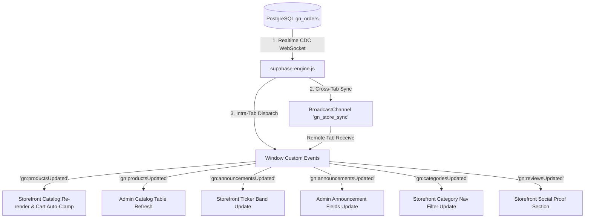

# GOTHIC NOVA — System Architecture & Code Connections Map

> **Audience:** Core Engineers & AI Coding Agents.  
> **Scope & Purpose (The "What" & "How"):** Living technical specification of the active system — structural topology, component responsibilities, data flow pipelines, schema contracts, event busses, function cross-references, SEO & Edge architecture, and mobile layout specifications.  
> **Architectural Decisions (The "Why"):** For historical context, problem statements, rejected hypotheses, and non-negotiable invariants, refer directly to [`structure/DECISIONS.md`](file:///c:/Users/tasaw/Desktop/gothic-nova-store/structure/DECISIONS.md).  
> **Maintenance Rule:** Keep this document modular, authoritative, and concise. Update active contracts and topologies when features change without repeating historical ADR narrative.

---

## 1. System Topology Overview

```
                                  +--------------------------------------------+
                                  |              SUPABASE CLOUD                |
                                  |  - PostgreSQL Database (Table: gn_orders)  |
                                  |  - Cloud Storage Bucket: product-media     |
                                  |  - Realtime WebSocket CDC Engine           |
                                  +---------------------+----------------------+
                                                        ^
                         +------------------------------+------------------------------+
                         | HTTPS REST (Serverless / SWR)|                              | Realtime WebSocket
                         v                              v                              v
        +--------------------------------+   +------------------------------+   +------------------------------+
        |   VERCEL SERVERLESS EDGE API   |   |      supabase-engine.js      |   |  Realtime Subscription Bus   |
        |      (api/sitemap.js)          |   |  - Singleton Supabase Client |   |  - CDC 'gn_realtime_sync'    |
        |  - Zero-dependency Node.js     |   |  - SafeStorage SWR Cache     |   |  - Remote Tab Realtime Push  |
        |  - Live products sitemap query |   |  - Serialized Save Queue     |   +--------------+---------------+
        |  - Edge cache (s-maxage=3600)  |   +--------------+---------------+                  |
        +---------------+----------------+                  |                                  |
                        |                                   +-----------------+----------------+
                        | Rewrite: /sitemap.xml                               |
                        v                                                     v
        +--------------------------------+          +---------------------------------------------------+
        |      SEARCH ENGINE CRAWLERS    |          | BroadcastChannel ('gn_store_sync') / Window Events|
        |  - Googlebot / Bingbot         |          +-------------------------+-------------------------+
        |  - Canonical: gothicnova.com   |                                    |
        +--------------------------------+                    +---------------+---------------+
                                                              v                               v
                                            +-----------------------------------+   +-----------------------------------+
                                            |      STOREFRONT (index.html)      |   |        ADMIN (admin.html)         |
                                            |  - SafeStorage Sandbox Immunity   |   |  - Catalog Manager & Stock Stepper|
                                            |  - Responsive Hero Preloads (CWV) |   |  - Categories & Hierarchy Editor  |
                                            |  - Persistent Cart & Viewport Lock|   |  - Announcement Band Live Form    |
                                            |  - Static Hero & Crawling Curtain |   |  - Reviews & Ratings Moderation   |
                                            |  - 48h Tarot Gamification Ritual  |   |  - Live Orders Feed & Status Mod  |
                                            |  - Dynamic SEO & JSON-LD Graph    |   |  - Client-side WebP Image Uploader|
                                            |  - search-engine.js Integration   |   |  - Single-Loader Mutation Queue   |
                                            +-----------------------------------+   +-----------------------------------+
```

---

## 2. Component Relations & Responsibilities

| Component | Primary File(s) | Role & Dependencies |
| :--- | :--- | :--- |
| **Data Engine Layer** | `supabase-engine.js` | Authoritative persistence bridge. Connects to Supabase JS SDK (`@supabase/supabase-js@2`), manages `SafeStorage` SWR caching, serializes writes to `gn_orders`, handles storage uploads to `product-media`, and broadcasts updates. |
| **Dynamic Sitemap Engine** | `api/sitemap.js` | Zero-dependency native Node.js serverless endpoint. Queries Supabase directly for active catalog products, dynamically generates standard XML sitemap for crawlers, and serves Edge caching headers (`s-maxage=3600`). |
| **Storefront App** | `index.html`, `style.css` | Customer interface. Consumes `window.SupabaseEngine` with `SafeStorage`, renders responsive catalog with static hero backdrop and crawling curtain, handles search filtering, persistent cart state, checkout modal, tarot ritual, and injects dynamic SEO structured data. |
| **Admin Operations** | `admin.html`, `style.css` | Merchant console. Consumes `window.SupabaseEngine`, performs authenticated catalog CRUD, adjusts inventory with awaited writes, uploads WebP images, edits announcements, and manages customer orders. |
| **Search Engine** | `search-engine.js` | Fast client-side catalog indexing. Tokens, fuzzy matching, search dropdown, scroll-to-target highlighting (`.product-search-highlight`). |
| **Scroll Engine** | `scroll-engine.js` | Viewport effects, header shrink, ambient lighting tracking, smooth scroll interactions. |
| **Styling System** | `style.css` | Obsidian-gold-crimson luxury cyberpunk gothic design system, typography tokens, responsive layouts, modals, keyframe animations. |

---

## 3. Communication & Event Bus Architecture

Cross-tab and cross-device synchronization relies on a 3-tier reactive hierarchy:



### Event Reference
* `gn:productsUpdated` (payload: `{ products: Product[] }`): Dispatched when product data is fetched or updated. Triggers catalog re-render and cart inventory clamping.
* `gn:announcementsUpdated` (payload: `{ announcements: string[] }`): Dispatched when announcements change. Expands or updates `#saleTickerBand`.
* `gn:categoriesUpdated` (payload: `{ categories: Category[] }`): Dispatched when categories change. Updates category tabs.
* `gn:reviewsUpdated` (payload: `{ reviews: Review[] }`): Dispatched when customer reviews update.
* `gn:cartUpdated`: Dispatched internally in `index.html` on cart mutations. Updates cart badge count, drawer totals, and discount subtotals.

---

## 4. Entity Schema & Data Contracts

### 4.1 Database Table: `gn_orders` (Supabase PostgreSQL)
Used for both customer orders and isolated configuration sections:

| Column | Type | Description |
| :--- | :--- | :--- |
| `id` | `bigint / uuid` | Primary Key. |
| `order_number` | `integer` | Unique sequential human-readable identifier (Customer orders: positive starting at `#1`; System config rows: negative `< 0`). |
| `customer_name` | `text` | Customer full name OR Section Identifier (`__GN_SYNC_PRODUCTS__`, `__GN_SYNC_ANNOUNCEMENTS__`, `__GN_SYNC_CATEGORIES__`, `__GN_SYNC_REVIEWS__`). |
| `customer_phone`| `text` | Customer contact number (empty for config sections). |
| `customer_address`| `text` | Shipping address (empty for config sections). |
| `total_amount` | `numeric` | Order total in PKR (0 for config sections). |
| `status` | `text` | Order status (`pending`, `confirmed`, `dispatched`, `cancelled`). |
| `items` | `jsonb` | Ordered items array OR Section container: `{ [sectionKey]: [...], updated_at: "<ISO>" }`. |
| `created_at` | `timestamptz` | Row creation timestamp. |
| `updated_at` | `timestamptz` | Last updated timestamp. |

### 4.2 Product Contract
```typescript
interface Product {
    id: string;               // Unique string identifier (e.g. "1", "1728312000000")
    name: string;             // Display name (e.g. "Dragon Ring")
    category: string;         // Category slug ("rings", "chains", "pendants", "bracelets")
    price: number;            // Regular price in PKR
    salePrice: number | null; // Discounted price in PKR (or null if not on sale)
    stock: number;            // Total units available in inventory
    threshold: number;        // Low-stock alert threshold (default 3)
    desc: string;             // Product specifications and marketing copy
    img: string;              // Primary image: HTTPS URL from 'product-media' or optimized WebP
    stock_images: string[];   // Secondary gallery image URLs
    active: boolean;          // true = visible in storefront, false = hidden
    display_order: number;    // Sort order index
}
```

### 4.3 Category Contract
```typescript
interface Category {
    id: string;            // Slug ("rings", "chains", "pendants", "bracelets")
    name: string;          // Human-readable title ("Rings", "Chains")
    display_order: number; // Sequence index in nav bar
}
```

### 4.4 Announcement Contract
```typescript
type Announcements = string[]; 
// Max 5 items. Example: ["High quality packaging", "COD available nationwide across Pakistan"]
```

### 4.5 Customer Review Contract
```typescript
interface Review {
    id: string;               // Unique ID (e.g. "rev_1728312000000")
    customer_name: string;    // Reviewer name (e.g. "Zainab K.")
    rating: number;           // Star rating: 1 to 5
    comment: string;          // Customer testimonial text
    verified: boolean;        // true if confirmed purchaser
    approved: boolean;        // Admin moderation flag (true = visible on storefront)
    created_at: string;       // ISO date string
    product_id?: string;      // Optional specific product linkage
}
```

### 4.6 Customer Order & Payment Proof Contract
```typescript
interface CustomerOrder {
    id?: string;              // PostgreSQL ID or Order Number (e.g. "GN-1042")
    customer_name: string;    // Full shipping name
    phone_number: string;     // Active WhatsApp/mobile number for courier dispatch
    house_flat_no: string;    // Apartment / Flat / House number
    street_address: string;   // Street and locality
    city: string;             // Destination city in Pakistan
    province?: string;        // Province
    nearest_landmark?: string;// Prominent local landmark
    payment_method: "cod" | "advance"; // Cash on Delivery vs Bank/Easypaisa
    payment_screenshot?: string; // WebP DataURL or Storage URL of customer's transfer receipt
    total_amount: number;     // Final payable in PKR
    discount_applied?: number;// Value subtracted via Tarot reward or promo
    promo_code?: string;      // Active code / reward title
    status: "pending" | "confirmed" | "dispatched" | "delivered" | "cancelled";
    created_at?: string;
    items: Array<{
        id: string;           // Product ID
        name: string;         // Product name
        price: number;        // Unit price in PKR
        qty: number;          // Quantity ordered (capped by product.stock)
        img: string;          // Product thumbnail
    }>;
}
```

---

## 5. Intake Pipelines: Media & Search Architecture

### 5.1 Search Architecture (Dual-Surface Indexing)
1. **Storefront Instant Search Engine (`search-engine.js`):**
   - **Indexing:** Indexes active catalog products in memory across `name`, `category`, `desc`, and `id`.
   - **Fuzzy Token Matching:** Splits queries into word stems, scoring exact prefix hits highest.
   - **Interactive Navigation:** Renders instant drop results. Selecting an item closes the search overlay, executes smooth scroll to `#product-<id>`, and triggers the `.product-search-highlight` animated neon glow pulse.
   - **Keyboard Navigation:** Supports arrow key selection, Escape to dismiss, Enter to open.
2. **Admin Realtime Filter Search (`admin.html`):**
   - **Catalog Filter:** Live debounced search across product names, prices, and categories.
   - **Order Search:** Live search filtering across customer name, phone number, city, and order ID.

### 5.2 Image Intake Pipeline: Product Media & Payment Receipts

```mermaid
flowchart TD
    subgraph ProductMedia [Product Media Intake - admin.html]
        P_FILE[Merchant Selects 1 Primary + up to 3 Stock Images] --> P_COMP[compressImageFile: 800x800 Canvas WebP @ 20KB]
        P_COMP --> P_UP[SupabaseEngine.uploadProductImage]
        P_UP --> P_BUCKET[(Supabase Storage Bucket: product-media)]
        P_BUCKET --> P_URL[Public HTTPS CDN URL: /storage/v1/object/public/product-media/products/...]
        P_URL --> P_ROW[Committed to __GN_SYNC_PRODUCTS__ items array]
    end

    subgraph PaymentProof [Payment Proof Intake - index.html Checkout]
        C_FILE[Customer Attaches Bank / Easypaisa Screenshot] --> C_COMP[handlePaymentScreenshotUpload: Canvas WebP Compression]
        C_COMP --> C_ATTACH[Embedded into Order Payload: payment_screenshot]
        C_ATTACH --> C_DB[(gn_orders: Dedicated Customer Order Row)]
        C_DB --> C_VIEW[Admin Order Modal: High-Res Receipt Viewer]
    end
```


### 5.3 Reviews System Architecture
1. **Intake & Submission:** Storefront allows patrons to submit reviews with star ratings (1 to 5) and feedback comments.
2. **Persistence:** Reviews are serialized in `gn_orders` under `customer_name = '__GN_SYNC_REVIEWS__'`.
3. **Admin Moderation:** Reviews appear in `admin.html` Reviews Tab with actions to Approve, Reject, Delete, or Create manual editorial testimonials.
4. **Storefront Rendering:** Only records with `approved === true` are rendered in the testimonials carousel.

---

## 6. Comprehensive Admin Panel Actions Catalog

Every capability supported in `admin.html` is indexed below:

| Section | Action / Control | Mechanism | Data Impact |
| :--- | :--- | :--- | :--- |
| **Authentication** | Permanent Session Unlock | `checkAdminAuth()` / PIN Gate | Sets `gn_admin_permanent_auth = 'unlocked'` |
| **Authentication** | Secure Logout | `logoutAdmin()` | Clears auth tokens, redirects to gate |
| **Catalog** | Add Single Product | Modal form + `saveSingleProduct()` | Appends to products array, saves to Supabase |
| **Catalog** | Edit Product | Modal form + `saveSingleProduct()` | Updates existing product object |
| **Catalog** | Duplicate Product | `duplicateProduct(id)` | Copies specs with new ID and appends |
| **Catalog** | Delete Product | `deleteProduct(id)` | Confirmation modal -> removes from array |
| **Catalog** | Toggle Active State | `toggleProductActive(id)` | Sets `p.active = !p.active`, updates cloud |
| **Catalog** | Instant Stock Adjust (`+`/`-`) | `adjustCatalogStock(id, delta)` | Awaited `updateProductStock()` on Supabase |
| **Catalog** | Quick Restock Modal | `promptQuickRestock(id)` | Sets custom stock amount with awaited write |
| **Catalog** | Batch / Bulk Upload | CSV / Multi-File Intake | Iterates queue, uploads media, commits bulk |
| **Catalog** | Filter by Category | Category selector pills | Filters DOM grid without mutating data |
| **Categories** | Create Category | `createCategory()` | Adds category with auto-slugged ID |
| **Categories** | Rename Category | `renameCategory()` | Updates name across category and products |
| **Categories** | Delete Category | `deleteCategory()` | Removes category, reassigns products to 'general' |
| **Categories** | Reorder Categories | Drag/Order Index Inputs | Updates `display_order` sequence |
| **Announcements** | Edit Live Offer Slots | 5 input fields in Admin Form | Serializes up to 5 strings into array |
| **Announcements** | Save Announcements | `saveAnnouncementsFromAdmin()` | Awaited write to `__GN_SYNC_ANNOUNCEMENTS__` |
| **Announcements** | Clear All Offers | Clear button | Clears inputs and saves empty array (hides banner) |
| **Orders** | Filter Status Tabs | `setOrderFilter('pending' \| 'confirmed' \| 'dispatched')` | Client-side status slice |
| **Orders** | Search Orders | `handleOrderInlineSearch(query)` | Live fuzzy filter by customer name/phone/ID |
| **Orders** | Update Order Status | Status dropdown selector | Updates row `status` directly in `gn_orders` |
| **Orders** | View Payment Proof | Receipt modal lightbox | Displays high-resolution uploaded receipt |
| **Orders** | Quick WhatsApp Contact | WhatsApp API button (`wa.me/<phone>`) | Opens direct chat with customer |
| **Reviews** | Approve / Publish Review | `toggleReviewApproval(id)` | Sets `approved = true`, pushes to cloud |
| **Reviews** | Delete Review | `deleteReview(id)` | Removes review from `__GN_SYNC_REVIEWS__` |
| **Reviews** | Add Editorial Review | Manual review modal | Injects curated customer testimonial |
| **Settings** | Default Stock Level | Setting input (`gn_default_stock`) | Configures baseline stock for newly created items |
| **Settings** | Cloud Force Re-Sync | `refreshFromCloud()` | Bypasses SWR cache and pulls fresh Supabase rows |
| **Settings** | Database Backup Export | JSON Download button | Exports full catalog and orders snapshot |

---

## 7. End-to-End Execution Pipelines

### 7.1 Storefront Hydration Pipeline (`index.html`)
1. **0ms SWR Load:** `localStorage.getItem('gn_swr_products')` hydrates `window.gn_products`. If present, renders catalog immediately.
2. **Background Supabase Fetch:** `hydrateStorefrontFromCloud()` invokes `SupabaseEngine.getProducts()`, `getAnnouncements()`, `getCategories()`.
3. **DOM Patching:**
   - Catalog grid swaps skeletons or re-renders with fresh database records.
   - Announcement band (`#saleTickerBand`) unhides and populates `#saleTickerTrack`.
   - Category navigation pills refresh.
4. **Dynamic SEO Trigger:** Calls `injectDynamicSEO()` to generate metadata and Schema.org graph from the verified catalog.

### 7.2 Admin Mutation & Save Pipeline (`admin.html`)
1. **Input & Image Processing:** Merchant inputs product details. If an image file is chosen, `compressImageFile(file, 800, 0.75)` converts it to a ~20 KB WebP Blob.
2. **Media Upload:** `SupabaseEngine.uploadProductImage(blob)` sends file to Supabase Storage bucket `product-media` and replaces image with public HTTPS URL.
3. **Single-Loader Lifecycle:** When save is clicked, the button inside the modal transitions into the spinner. The floating background pill is strictly suppressed while the modal is open to prevent competing double loaders.
4. **Premature Dismissal Handling:** If the merchant closes the modal or dismisses the bottom sheet before the promise settles, `closeAllModals()` detects the in-flight operation and surfaces the luxury obsidian floating pill (`#admin-floating-status-pill`) centered horizontally at the bottom.
5. **Awaited Persistence Queue:** Calls `SupabaseEngine.saveProduct()` or `saveProductsBulk()`. The engine queues the write via `_sectionSaveQueue['products']` and awaits the PostgreSQL update on `gn_orders`.
6. **UI Confirmation & Broadcast:**
   - If modal remained open: button turns green `SAVED ✓` for 1.2s, toast fires, modal closes automatically.
   - If modal was closed early: the centered floating status pill transitions to green checkmark `SAVED ✓` for 2.4s and fades out.
   - `BroadcastChannel` and Supabase Realtime automatically notify all open client storefronts and mobile devices.

### 7.3 Inventory Integrity & Auto-Clamp Pipeline
1. **Ceiling Verification:** Storefront disables the `+` quantity button whenever `currentQty >= product.stock`.
2. **Realtime Clamp:** When `gn:productsUpdated` fires:
   ```javascript
   Object.keys(window.gn_cart).forEach(id => {
       const prod = window.gn_products.find(p => String(p.id) === String(id));
       if (prod && window.gn_cart[id].qty > prod.stock) {
           window.gn_cart[id].qty = Math.max(0, prod.stock);
           showCartClampNotice(prod.name, prod.stock);
       }
   });
   ```
3. **Out-of-Stock State:** Products with `stock <= 0` render `SOLD OUT` pill and prevent cart addition.
4. **Atomic Checkout Reservation:** When `createOrder(orderData)` executes, it verifies `product.stock >= item.qty` for all items. If insufficient, it throws `INSUFFICIENT_STOCK: ...`. Upon successful insert, it decrements `product.stock` and dispatches `gn:productsUpdated`.
5. **Replenishment on Cancellation:** When an order transitions to `Cancelled` or is deleted in `admin.html`, its reserved units are replenished back into active inventory.

### 7.4 Add-to-Cart & Checkout Execution Pipeline
1. **Persistent Cart CTA Transition:** When a customer clicks `ADD TO CART` in the PDP modal, the item is added to `window.gn_cart` (using coerced string IDs). The CTA button transitions permanently to `VIEW CART (${newTotalQty})`. It does not revert via arbitrary timeouts. Clicking it directly invokes `openCart()`.
2. **Secondary Add-More Units Stepper:** Below modal actions, `#pdpAddMoreBtn` (`+ Add another unit`) allows adding incremental units. Clicking it or clicking the modal quantity stepper `+` button changes the button state back to `ADD (+1) TO CART`, giving patrons an intuitive mechanism to stack quantity without drawer toggling.
3. **String ID Coercion:** All lookups, insertions, deletions, and clamp reconciliations coerce `String(pid).trim()` to eliminate numeric vs string key collisions.
4. **Mobile Cart Drawer Viewport Containment:** `#cart-items-list` enforces `max-height: calc(100dvh - 210px)` and `overscroll-behavior-y: contain`. This guarantees that `#cart-footer` (with total PKR amount and checkout button) remains pinned and completely visible on all mobile viewports.

---

## 8. Key Functions Cross-Reference

| Module / File | Function / Symbol | Callers | Purpose |
| :--- | :--- | :--- | :--- |
| `supabase-engine.js` | `_getSection(sectionKey, forceFresh)` | `getProducts`, `getAnnouncements`, etc. | Reads `SafeStorage` SWR cache first, then fetches authoritative single row from Supabase. |
| `supabase-engine.js` | `_saveSection(sectionKey, data)` | `saveProductsBulk`, `saveAnnouncements`, etc. | Serializes writes, awaits database response, updates SWR key. |
| `supabase-engine.js` | `uploadProductImage(fileOrDataUrl)` | `commitProductsToStore`, `saveSingleProduct` | Uploads WebP blob to `product-media` bucket, returns public URL. |
| `supabase-engine.js` | `updateProductStock(id, newStock)` | Admin stock `+`/`-` buttons | Atomically updates product stock in the database with awaited confirmation. |
| `supabase-engine.js` | `subscribeRealtime()` | Boot scripts in `index.html`, `admin.html` | Initializes singleton Supabase WebSocket channel (`gn_realtime_sync`). |
| `api/sitemap.js` | `handler(req, res)` | Vercel `/sitemap.xml` rewrite | Serverless edge function dynamically generating XML sitemap from Supabase active products with 1h edge cache. |
| `index.html` | `SafeStorage` polyfill | Storage operations across storefront | In-memory fallback layer preventing SecurityError crashes in sandboxed webviews (Instagram, Facebook IAB). |
| `index.html` | `hydrateStorefrontFromCloud()` | DOMContentLoaded | Orchestrates initial parallel fetch of products, announcements, categories. |
| `index.html` | `renderMainCatalog()` | Hydration, filter changes, search queries | Renders catalog product cards into `#main-drop-grid`. |
| `index.html` | `renderSaleTicker()` | Hydration, realtime events | Updates ticker text and controls visibility of `#saleTickerBand`. |
| `index.html` | `injectDynamicSEO()` | Post-catalog hydration | Builds and injects dynamic Title, Meta Description, OG tags, and Schema.org graph. |
| `index.html` | `#pdpAddMoreBtn` click listener | PDP modal interaction | Smoothly sets button back to `ADD (+1) TO CART` for multi-unit cart stacking. |
| `admin.html` | `loadProducts()` | Admin boot & refresh | Loads products into memory and renders admin catalog table/accordions. |
| `admin.html` | `adjustCatalogStock(id, delta)` | Stock `+`/`-` buttons | Calls `updateProductStock` with spinner and error handling (zero fake success). |
| `search-engine.js` | `performSearch(query)` | Search modal input | Filters catalog and pulses target element on storefront. |

---

## 9. SEO Architecture & Search Optimization

Gothic Nova features a dual-layer SEO architecture combining static crawl foundations with a dynamic runtime metadata engine:

### 9.1 Crawl & Dynamic Sitemap Infrastructure
1. **Robots Policy (`robots.txt`):**
   - Publicly indexable: `/`, `/category.html`, `/assets/*`.
   - Disallowed from crawling: `/admin.html`, `/admin`, `/dashboard.html`, `/dashboard`.
   - Sitemap reference: `Sitemap: https://gothicnova.com/sitemap.xml`.
2. **Serverless Dynamic Sitemap (`api/sitemap.js`):**
   - Clean route rewrite via `vercel.json`: `/sitemap.xml` -> `/api/sitemap.js`.
   - Native Node.js execution (zero npm dependencies).
   - Dynamically queries Supabase `gn_orders` (`__GN_SYNC_PRODUCTS__`) to enumerate all active products.
   - Outputs valid XML `<urlset>` containing root (`priority: 1.0`), `/category.html` (`priority: 0.8`), and each active product URL `https://gothicnova.com/?product=<id>` (`priority: 0.9`, `changefreq: weekly`).
   - Serves edge caching header: `Cache-Control: s-maxage=3600, stale-while-revalidate=86400`.
3. **Canonical Mapping:**
   - Canonical link tag in `<head>`: `<link rel="canonical" href="https://gothicnova.com/">`.

### 9.2 Dynamic Head & Social Graph Engine (`injectDynamicSEO()`)
When catalog products load, `injectDynamicSEO()` in `index.html` dynamically optimizes head tags:
* **Dynamic Document Title:** Injects top catalog items into the title:  
  `GOTHIC NOVA | Buy <Product1>, <Product2> Online in Pakistan — Gothic Jewelry`.
* **Dynamic Meta Description:** Extracts top active products with live PKR pricing:  
  `Shop GOTHIC NOVA: <Product1> (Rs. 1,000), <Product2> (Rs. 1,500) & more. Premier cyber-goth & Japanese jewelry with Cash on Delivery across Pakistan. Free shipping over Rs. 5,000.`
* **OpenGraph & Twitter Card Meta:**
  - `og:title` & `twitter:title`: Product-tailored titles for high click-through rates.
  - `og:description`: Detailed social snippet mentioning Cash on Delivery across Pakistan.
  - `og:image` & `twitter:image`: Canonical high-resolution preview (`https://gothicnova.com/assets/hero_gothic_bg.png`).
  - `og:url`: `https://gothicnova.com/`.

### 9.3 Schema.org Dynamic JSON-LD Structured Data Graph
Injected into `<head>` under `<script type="application/ld+json" id="gn-dynamic-jsonld">`:

```json
{
  "@context": "https://schema.org",
  "@graph": [
    {
      "@type": "Organization",
      "@id": "https://gothicnova.com/#organization",
      "name": "Gothic Nova",
      "url": "https://gothicnova.com",
      "logo": "https://gothicnova.com/assets/reaper_pendant.png",
      "description": "Pakistan's premier cyber-goth & Japanese editorial jewelry brand offering artisanal rings, chains, chokers, and pendants with Cash on Delivery nationwide.",
      "areaServed": "PK"
    },
    {
      "@type": "WebSite",
      "@id": "https://gothicnova.com/#website",
      "name": "Gothic Nova",
      "url": "https://gothicnova.com",
      "publisher": { "@id": "https://gothicnova.com/#organization" },
      "potentialAction": {
        "@type": "SearchAction",
        "target": "https://gothicnova.com/?q={search_term_string}",
        "query-input": "required name=search_term_string"
      }
    },
    {
      "@type": "Product",
      "@id": "https://gothicnova.com/?product=1#product",
      "name": "Dragon",
      "image": "https://ogjyubekshcxcirlboue.supabase.co/storage/v1/object/public/product-media/products/prod_1.webp",
      "description": "Dragon - Handcrafted gothic jewelry by Gothic Nova. Available with Cash on Delivery across Pakistan.",
      "sku": "GN-1",
      "brand": { "@type": "Brand", "name": "Gothic Nova" },
      "offers": {
        "@type": "Offer",
        "price": 1000,
        "priceCurrency": "PKR",
        "availability": "https://schema.org/InStock",
        "itemCondition": "https://schema.org/NewCondition",
        "url": "https://gothicnova.com/?product=1",
        "seller": { "@id": "https://gothicnova.com/#organization" }
      }
    }
  ]
}
```

### 9.4 Core Web Vitals, Preload & Edge Caching Directives
Optimized to ensure 95+ performance scores and minimal LCP/CLS:
* **Responsive Mobile Hero Preloads:**
  - `<link rel="preload" as="image" href="assets/website_bg_mobile.jpg" media="(max-width: 768px)" fetchpriority="high">`
  - `<link rel="preload" as="image" href="assets/hero_gothic_bg.png" media="(min-width: 769px)" fetchpriority="high">`
* **Connection Warming:**
  - `<link rel="dns-prefetch" href="https://cdn.jsdelivr.net">`
  - `<link rel="preconnect" href="https://cdn.jsdelivr.net" crossorigin>`
  - `<link rel="dns-prefetch" href="https://ogjyubekshcxcirlboue.supabase.co">`
  - `<link rel="preconnect" href="https://ogjyubekshcxcirlboue.supabase.co" crossorigin>`
* **Script Optimization:**
  - `@supabase/supabase-js@2` and `supabase-engine.js` execute with `defer` to prevent parser blocking.
* **Vercel Edge Caching Headers (`vercel.json`):**
  - JS/CSS: `public, max-age=86400, stale-while-revalidate=604800`
  - Images/Fonts: `public, max-age=31536000, immutable`
* **Rendering & Layout Shift Protection:**
  - `.card-img-wrapper`: Enforces `aspect-ratio: 1 / 1` to prevent layout shifts during image decoding.
  - `.reviews-section`, `.store-footer`: Utilize `content-visibility: auto; contain-intrinsic-size: 1px 500px;` to skip offscreen rendering costs.

---

## 10. Mobile Viewport Fluid Topology & Layout Specifications

> **Historical Rationale:** For detailed failure modes and design evolution, see [ADR-013](file:///c:/Users/tasaw/Desktop/gothic-nova-store/structure/DECISIONS.md#adr-013-mobile-viewport-fluid-topology-single-line-category-locking--render-thrash-coalescing) and [ADR-020](file:///c:/Users/tasaw/Desktop/gothic-nova-store/structure/DECISIONS.md#adr-020-static-wall-hero-backdrop-crawling-curtain-topology--marquee-speed-calibration).

### 10.1 Static Hero Backdrop & Crawling Curtain Specification
* **Static Hero Section (`.hero-section`):**
  - CSS Contract: `position: fixed !important; top: 0 !important; left: 0 !important; width: 100% !important; height: 100vh !important; height: 100dvh !important; z-index: 1 !important; overflow: hidden !important;`
  - The hero backdrop remains fixed in place as a dramatic backdrop during initial page load and scrolling.
* **Crawling Curtain Product Section (`.active-drop-section`):**
  - CSS Contract: `margin-top: 100vh !important; margin-top: 100dvh !important; position: relative !important; z-index: 10 !important; background-color: #0a0508 !important;`
  - Zero-peeking guarantee: At `scrollY = 0`, the product section begins strictly below the visible viewport fold.
  - Upon user scroll, the opaque `#0a0508` section slides smoothly upwards over the hero backdrop.
* **New Arrivals Marquee Calibration:**
  - Storefront script (`index.html`): `baseSpeed = 0.48` (~29px/sec).
  - Stylesheet (`style.css`): Keyframe duration set to `35s` for mobile devices.

### 10.2 Mobile Fluid Clamping Rules
Hero text and decorative statues adapt dynamically across display ratios (320px–430px+) using viewport-relative clamping:
* **Hero Title ("GOTHIC NOVA"):** `font-size: clamp(4.0rem, 18.2vw, 4.3rem); max-width: 98vw !important; box-sizing: border-box;`
* **Statue Vertical Elevation:** `transform: translateY(clamp(-180px, -21.3vh, -155px));` (with fallback to `var(--statue-y, -180px)`).
* **Flanking Subtext Single-Line Guarantee:** Center spacing gap `clamp(48px, 14vw, 82px)`; typography `clamp(6.6px, 2.1vw, 7.5px)`; `max-width: 94vw !important`.

### 10.3 Category Filter Bar Single-Line Contract
The filter bar (`.category-filter-container`) is locked to a single horizontal row across all viewports:
* Container: `flex-wrap: nowrap !important; justify-content: space-between !important; overflow-x: hidden !important;`
* Tabs (`.filter-tab`, `.cat-more-btn`): `flex: 1 1 0 !important; min-width: 0 !important; padding: 0 clamp(4px, 1.5vw, 10px) !important; font-size: clamp(0.64rem, 2.1vw, 0.74rem) !important; white-space: nowrap !important; text-overflow: ellipsis !important;`

### 10.4 Idempotent DOM Fingerprinting & RAF Coalescing
* **Content Signatures (`_lastReviewsKey`, `_lastCatalogKey`, `_lastArrivalsKey`):** Serialized hash check before touching `innerHTML`. Identical signatures skip DOM rebuilds entirely.
* **Refresh Coalescing:** Asynchronous events (`DOMContentLoaded`, `productsLoaded`, `reviewsUpdated`, `BroadcastChannel`) are batched into a single `requestAnimationFrame` pass via `refreshStorefrontCatalog()`, eliminating visual layout thrash.

---

## 11. Performance, Core Web Vitals (CWV) & Asset Acceleration Pipeline

```
                                  +---------------------------------------+
                                  |     INITIAL HTML DOCUMENT LOAD        |
                                  | - SafeStorage Bootstrap (Sync)        |
                                  | - Inline Critical CSS Tokens (Head)   |
                                  | - Single LCP Preload (fetchpriority)  |
                                  +-------------------+-------------------+
                                                      |
                                                      v  (FCP < 1.1s)
                                  +---------------------------------------+
                                  |      FIRST CONTENTFUL PAINT (FCP)     |
                                  | - Dark Canvas & Hero Geometry Paint   |
                                  | - Cached Cart Badge Counter Display   |
                                  | - Non-blocking Async Stylesheet Load  |
                                  +-------------------+-------------------+
                                                      |
                                                      v  (LCP < 2.3s)
                                  +---------------------------------------+
                                  |    LARGEST CONTENTFUL PAINT (LCP)     |
                                  | - Single Mobile WebP Hero Backdrop    |
                                  | - Hero Title & Fluid Typography Renders|
                                  | - Top 4 Catalog Cards Hydrated (SWR)  |
                                  +-------------------+-------------------+
                                                      |
                                                      v  (requestIdleCallback / Post-Load)
                                  +---------------------------------------+
                                  |    DEFERRED BACKGROUND CAPABILITIES   |
                                  | - Off-Screen Product Images (Lazy)    |
                                  | - Search Tokenizer (search-engine.js) |
                                  | - Supabase Realtime CDC WebSocket Bus |
                                  | - Social Proof & Reviews Carousel     |
                                  +---------------------------------------+
```

### 11.1 Render-Blocking Elimination (FCP Optimization)
* **Font Delivery Strategy:** Google Fonts stylesheet is loaded asynchronously via `<link rel="preload" as="style" onload="this.rel='stylesheet'">` with `display=swap`, scoped strictly to active weights (`Antonio:700`, `Inter:400;600;700`). Zero Flash of Invisible Text (FOIT).
* **Critical CSS Extraction:** Above-the-fold layout, dark body background `#0a0508`, and fixed hero constraints are inlined directly in `<head>` to paint on the very first TCP packet.

### 11.2 Single-LCP Asset Protocol (LCP Optimization)
* **Bandwidth Isolation:** Eliminates multiple competing preloads in `<head>`. On mobile viewports (`max-width: 768px`), strictly one single asset is tagged with `fetchpriority="high"` (`assets/website_bg_mobile.webp`). On desktop, `assets/hero_gothic_bg.webp` is prioritized.
* **Modern WebP Compression Standard:** All monolithic hero assets (`website_bg_mobile`, `hero_gothic_bg`, `gothic_cathedral_bg`, `subject_silhouette`, `gothic_card_back`) are converted from raw PNG/JPG to WebP at quality 82, reducing asset payload from ~800KB to ~160KB.

### 11.3 Catalog Off-Screen Image Decoupling
* **Native Browser Intersection:** Cards 1–4 above the fold load immediately; cards 5–14+ are decoupled with `loading="lazy" decoding="async" fetchpriority="low"`.
* **Zero CLS Guarantee:** Every product card preserves an explicit `aspect-ratio: 1 / 1` container with solid obsidian fallback color (`#12090d`), guaranteeing zero Cumulative Layout Shift while images stream into view.

### 11.4 Merchant Client-Side WebP Gateway (`admin.html`)
* **Automated Asset Ingestion:** When the merchant uploads raw product photography, `admin.html` draws the image to an offscreen HTML5 canvas capped at 800x800 resolution and exports `image/webp` (0.82 quality) before uploading to Supabase storage. Raw multi-megabyte smartphone uploads are permanently prevented from entering the catalog.

### 11.5 Main-Thread Scheduling Ladder (TBT Optimization)
* **Tier 1 (Synchronous / 0ms):** `SafeStorage` memory fallback, cart quantity badge count.
* **Tier 2 (Post-LCP / ~100ms):** Render catalog grid from SWR cache (`gn_swr_products`).
* **Tier 3 (Idle / `requestIdleCallback`):** Search token indexing (`search-engine.js`), Supabase Realtime WebSocket handshake, review tickers.

